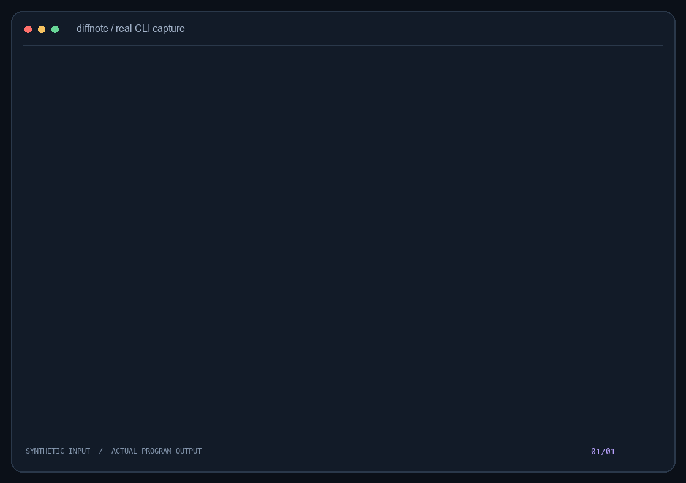
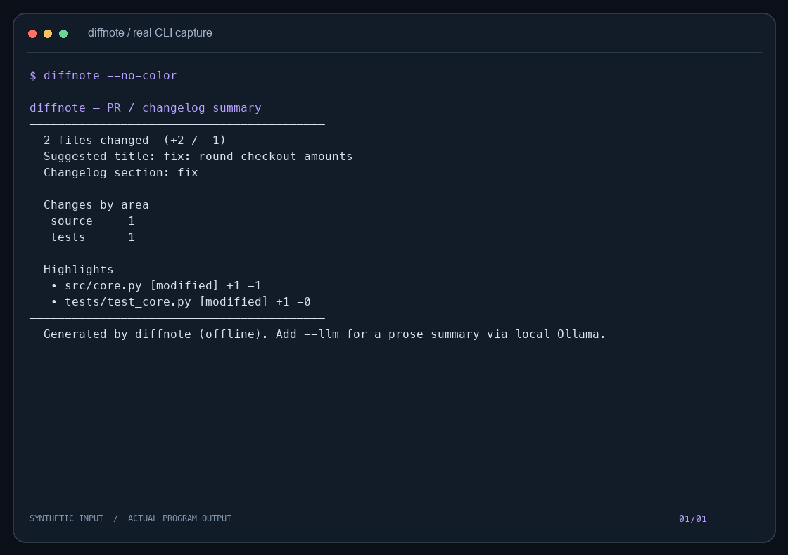
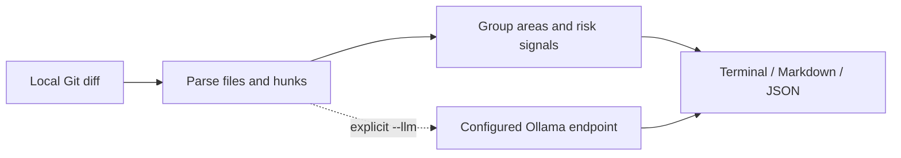

<p align="center"></p>
<h1 align="center">diffnote</h1>
<p align="center"><strong>Turn local Git changes into a reviewable pull request summary.</strong></p>

[](https://github.com/LucasYanzy/diffnote/actions/workflows/ci.yml) [](LICENSE) [](https://github.com/LucasYanzy/diffnote/blob/main/pyproject.toml)  [](https://github.com/LucasYanzy/diffnote/stargazers)

[English](README.md) · [简体中文](README.zh-CN.md)



The demo is captured from the real CLI using synthetic data. [Transcript](demo/terminal.txt) · regenerate with `python3 scripts/demo.py`.

## Why

Writing a PR description after the coding is finished is easy to postpone. diffnote groups a diff by area, highlights rule-based risk signals, and generates a starting point for the reviewer.

| Start with | Good for | Where diffnote helps |
|---|---|---|
| `git diff --stat` | Inspect change size | diffnote adds grouping and a PR-description draft. |
| Commit-log changelogs | Describe released commits | diffnote can also summarize tracked, uncommitted changes. |

## Quick start

```bash
git clone https://github.com/LucasYanzy/diffnote.git && cd diffnote
python3 -m pip install .
python3 scripts/demo.py
```

Install from this checkout to use the reviewed source version. The installed tool has no third-party runtime dependencies; cloning and installation can require network access.

## Features

### Choose your diff

Summarize tracked working-tree changes, staged changes, a base ref, or a commit range.

### Group the work

Bucket source, tests, docs, configuration and migrations; surface file and line-change counts.

### Export a draft

Generate terminal, Markdown or JSON output. Titles and risk signals are heuristics, not a semantic code review.

### Optional prose

`--llm` sends a bounded diff excerpt to the configured Ollama endpoint; the default is localhost and unavailable models fall back to rules.



## Usage

```bash
diffnote --staged
diffnote --base main --markdown
diffnote --range main..HEAD --json
diffnote --commits 2
```

## Architecture



## Privacy and limits

Default operation reads local Git data without network requests. `--llm` sends up to 6,000 diff characters and a suggested title to `DIFFNOTE_OLLAMA` (default `http://localhost:11434`). A remote setting sends that data off the machine. Reports can contain filenames and diff details. See [PRIVACY.md](PRIVACY.md) for data boundaries.

## Development

```bash
python3 -m pip install -e ".[test]"
python3 -m pytest -q
```

The demo uses a temporary fixture and does not inspect your personal repositories or agent homes.

## Roadmap

- [ ] Improve error messages for invalid refs and empty histories.
- [ ] Add configurable grouping rules.

## Contributing

Read [CONTRIBUTING.md](CONTRIBUTING.md). Report reproducible problems in [Issues](https://github.com/LucasYanzy/diffnote/issues). Follow [SECURITY.md](SECURITY.md) for sensitive reports.

## License

[MIT](LICENSE).
