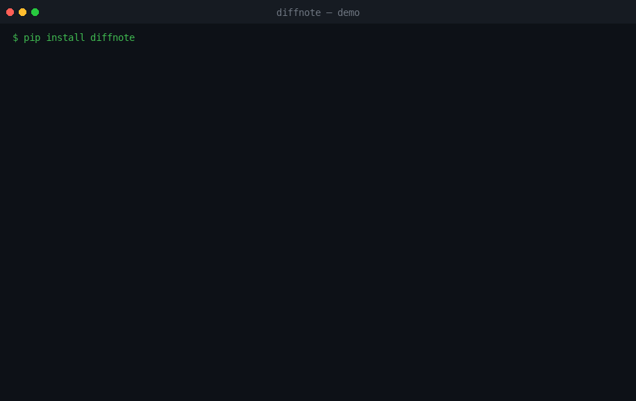

<p align="center">
  <h1 align="center">diffnote</h1>
  <p align="center"><b>Offline-first git diff → PR / changelog summary in one command.</b></p>
  <p align="center">
    <a href="./LICENSE"></a>
    
    
  </p>
</div>

<p align="center">
  
</p>

<p align="center"><code>pip install diffnote</code></p>

---

## What it does

`diffnote` reads your git changes and writes a clean, review-ready **PR description / changelog**
in seconds — **fully offline, zero config, no API key**. Point it at a repo and get:

- a suggested PR title + changelog section
- files grouped by area (source / tests / docs / config / migration / ci / i18n)
- **risk signals**: database migrations, auth/security changes, dependency bumps, large batches
- a highlighted file list
- optional natural-language prose via a **local** Ollama model (graceful fallback)

It is the antidote to "I'll just write the PR description later" — and to PR tools that
need a paid API key and ship your code to the cloud.

## Demo

*(real output, reproduced above in `demo.gif`)*

```text
$ diffnote
diffnote — PR / changelog summary
──────────────────────────────────────
  6 files changed  (+12 / -2)
  Suggested title: feat: bootstrap
  Changelog section: feat

  Risk signals
   • database migration / schema change (1)
       - migrations/0007_sessions.py
   • auth / security related (3)
       - migrations/0007_sessions.py
       - src/auth/session.py
       - tests/test_session.py
   • dependency change (1)
       - requirements.txt

  Changes by area
   source     2
   docs       1
   migration  1
   config     1
   tests      1

  Highlights
   • src/auth/session.py [modified] +2 -0  ⚠ auth / security related
   • migrations/0007_sessions.py [added] +2 -0  ⚠ database migration / schema change
   • requirements.txt [modified] +1 -1  ⚠ dependency change
   • tests/test_session.py [added] +2 -0  ⚠ auth / security related
   …
──────────────────────────────────────
  Generated by diffnote (offline). Add --llm for a prose summary via local Ollama.
```

## Install

One command, no dependencies:

```bash
pip install diffnote
```

(Or `pipx install diffnote` to keep it isolated. No compilation, no native deps — pure stdlib.)

## Quick start

In any git repository with changes:

```bash
diffnote                 # pretty terminal summary of your working tree
diffnote --staged        # only staged changes
diffnote --markdown      # GitHub PR-body markdown (paste-ready)
diffnote --commits 5     # summarize the last 5 commits
diffnote --base main     # changes vs main (great for PR prep)
diffnote --json          # machine-readable, for CI
diffnote --llm           # add a prose summary using local Ollama (optional)
```

That's the whole workflow. No config file, no sign-up, no telemetry.

## Features

- 🔌 **Zero runtime dependencies** — pure Python stdlib, installs in a second.
- 🔒 **Offline & private** — your code never leaves your machine.
- 🧭 **Smart grouping** — files bucketed by area automatically.
- 🚦 **Risk radar** — flags migrations, auth/security edits, dependency changes, huge diffs.
- ⚠️ **Breaking-change hints** — flags `!:` commit markers and diffs under public API paths.
- 🏷 **Title & section** — infers a conventional-commit title and changelog bucket.
- 🤖 **Optional local LLM** — `--llm` asks Ollama for a prose blurb; if Ollama isn't
  running it silently falls back to the offline summary.
- 📦 **Three outputs** — terminal, markdown, json.

## Compared to alternatives

| Tool | Offline | Zero-config | Diff-focused | Local LLM | Deps |
|------|:------:|:-----------:|:------------:|:---------:|:----:|
| **diffnote** | ✅ | ✅ | ✅ (working tree + commits) | ✅ optional | 0 |
| git-cliff | ✅ | ⚠ config file | ❌ (commits/tags) | ❌ | Rust |
| conventional-changelog | ✅ | ⚠ | ❌ (commits) | ❌ | Node |
| AI PR bots (Coderabbit, etc.) | ❌ | ❌ | ✅ | ☁️ cloud | API key |

`diffnote` is the only one that explains your **uncommitted working tree**,
runs with **no setup**, and keeps your code **local**.

## FAQ

**Does it need an LLM / internet?** No. Everything except `--llm` runs offline.

**Will it send my code anywhere?** No. There is no network call unless you pass `--llm`,
and then only to `localhost` (your Ollama).

**How do I change the Ollama model?** Set `DIFFNOTE_MODEL=llama3` and
`DIFFNOTE_OLLAMA=http://host:11434` env vars.

**Binary files?** Counted as changed but their contents aren't analyzed.

**Python 2?** No — Python 3.8+.

## Roadmap

- [ ] `--save` to write markdown straight into a PR template
- [ ] Breaking-change detection (`feat!:` / public API paths)
- [ ] `--stats` per-area totals
- [ ] Plugin hooks for custom risk rules
- [ ] Shell completion

See [`GOOD_FIRST_ISSUES.md`](./GOOD_FIRST_ISSUES.md) to start contributing.

## License

[MIT](./LICENSE) — do whatever you want, just keep the notice.
