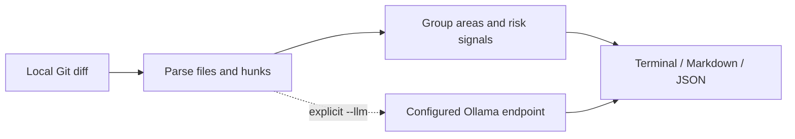

<p align="center"></p>
<h1 align="center">diffnote</h1>
<p align="center"><strong>将本地 Git 改动整理成便于审阅的 PR 摘要。</strong></p>

[](https://github.com/LucasXlab/diffnote/actions/workflows/ci.yml) [](LICENSE) [](https://github.com/LucasXlab/diffnote/blob/main/pyproject.toml)  [](https://github.com/LucasXlab/diffnote/stargazers)

[English](README.md) · [简体中文](README.zh-CN.md)


演示来自真实程序输出，输入全部为合成数据。[终端记录](demo/terminal.txt)；运行 `python3 scripts/demo.py` 可复现。

## 为什么需要它

写完代码后，PR 描述往往被拖到最后。diffnote 按区域整理差异，标注规则检测到的风险信号，产出可供人工审阅和修改的初稿。

## 快速开始

```bash
git clone https://github.com/LucasXlab/diffnote.git && cd diffnote
python3 -m pip install .
python3 scripts/demo.py
```

从当前检出目录安装即可运行已审阅的源码版本。安装后的工具无第三方运行依赖；克隆与安装过程仍可能需要联网。

## 功能

### 选择差异

支持已跟踪文件的工作区改动、暂存改动、基准 ref 与提交区间。

### 整理改动

按源码、测试、文档、配置与迁移等区域归类，展示文件数与行数。

### 导出初稿

输出终端、Markdown 或 JSON；用 `--markdown --save body.md` 可保存文件，成功时标准输出为空。标题与风险信号来自启发式规则，不代替语义审查。

### 可选模型润色

`--llm` 将有限长度的差异发往指定的 Ollama 端点，默认 localhost；模型不可用时回退到规则摘要。


## 使用

```bash
diffnote --staged
diffnote --base main --markdown
diffnote --range main..HEAD --json
diffnote --commits 2
diffnote --markdown --save body.md
diffnote --color
diffnote --no-color
```

默认仅在标准输出连接终端时使用 ANSI 颜色；`--color` 强制开启，`--no-color` 禁用。

破坏性变更提示只读取 `--commits`、`--range` 或 `--base` 所选比较范围内的 `!:` 提交标记，不再截断为最近 25 个提交。纯工作区或暂存摘要不套用历史提交标记；公共 API 路径提示仍对所有模式生效。

## 架构



## 隐私与边界

默认只读取本地 Git 数据，不联网。`--llm` 会把最多 6,000 个字符的差异与建议标题发往 `DIFFNOTE_OLLAMA`，默认 `http://localhost:11434`。若改成远程地址，数据会离开本机。报告可能包含文件名和改动细节。 详见 [PRIVACY.md](PRIVACY.md)。

## 开发与验证

```bash
python3 -m pip install -e ".[test]"
python3 -m pytest -q
```

演示只使用临时样例，不会扫描你的个人仓库或代理主目录。

## 路线图

请参阅[英文路线图](README.md#roadmap)，其中只列出尚未实现的工作。

## 贡献与许可

贡献方式见 [CONTRIBUTING.md](CONTRIBUTING.md)，安全问题见 [SECURITY.md](SECURITY.md)。采用 [MIT License](LICENSE)。
