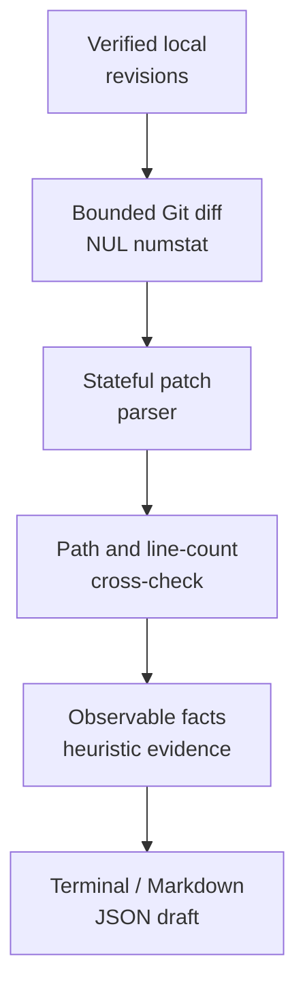

**English** · [简体中文](guide.zh-CN.md)

<p align="center"></p>

# diffnote

**Start a PR description from the change in front of you.**

<p align="center">


</p>

Turn local Git changes into a reviewable draft with changed areas, file metadata, line counts, and traceable review signals. No model, API key, or server is required.

[简体中文](../README.zh-CN.md) · [Quick start](#quick-start) · [Pick a diff](#pick-the-diff-you-want-to-describe) · [Limits](#privacy-and-limits) · [MIT](../LICENSE)


Real local CLI capture rendered as readable panels; the GIF adds 8–10 second reading holds and paginates JSON. No typing or CLI output is invented. [Static hero](../assets/demo.png) · [Unmodified cast](../assets/recording/showcase.cast) · [Full transcript](../assets/recording/showcase.txt) · [Sources and reproduction](../docs/showcase.md).

The five local badges describe source metadata and prepared configuration. CI has no claimed remote result; Stars are pending.
## From a diff to a useful first draft

You have changed a function and its test. `git diff --stat` shows the size; diffnote groups the visible changes into a draft and points to review signals with file-level evidence. Working-tree and staged drafts derive their title from the current changes rather than an unrelated previous commit.

Use it to assemble facts, then explain the intent and your real validation. It does not execute tests, infer the author's true intent, or approve the change.

| Starting point | Keep it for | Use diffnote when you also want |
|---|---|---|
| `git diff` | Reading the actual patch | A structured draft to edit alongside it |
| `git diff --stat` | Fast change-size inspection | Areas, file metadata, and review signals |
| Commit log | Following committed history | A draft for staged or uncommitted tracked changes |

## Quick start

From this source checkout, with Python 3.11+ and Git 2.31+ on macOS or Linux:

```sh
python3 -m venv .venv
.venv/bin/python -m pip install .
.venv/bin/python scripts/demo.py
```

The demo runs the installed CLI on temporary synthetic Git data and removes it afterward. Installation can download build tools; runtime analysis makes no network or model requests. No package-registry release or remote CI pass is claimed. Repository metadata targets LucasXlab/diffnote; these source files do not establish which remote revision is published.

## Pick the diff you want to describe

After activating `.venv`:

| Your next action | Command | What it includes |
|---|---|---|
| Review the next commit | `diffnote --staged --markdown` | The index only |
| Explain local tracked edits | `diffnote --markdown` | Tracked working-tree changes, including staged edits |
| Prepare a branch draft | `diffnote --base main --markdown` | The verified local base comparison |
| Feed a local script | `diffnote --staged --json` | Structured metadata and evidence |

Untracked files enter the analysis only after staging. Read the generated draft together with the actual patch, and add the reason for the change and the tests you really ran. CLI output is local; inspect it before sharing.

## Features

### Match the draft to your next commit

Working-tree analysis includes staged tracked edits; `--staged` includes only the index. In this fixture the working tree contains source and documentation edits, while the staged draft contains documentation only. Base and range modes use verified local revisions; see [Usage](#usage).


### Keep file facts intact

Empty files, binary changes, renames and executable modes survive the summary. Binary content has no text line counts. JSON preserves quoted/Unicode/control-character filename identity; terminal and Markdown make control characters visible.


### Trace review signals to evidence

Finite rules identify a path, rule and added/deleted/path source. A removed security keyword remains visible in this example. Signals are prompts to inspect the patch; their absence is not evidence of safety. The tool does not execute tests.


### Use terminal, Markdown or JSON

The [complete JSON](../assets/recording/metadata-json.json) retains file facts and limitations. The image below shows page 1 of a labelled `source/files/limits` projection; all pages appear in the GIF. [Markdown output](../assets/recording/signals-markdown.stdout.txt) is also preserved.


### Fail visibly on unsupported inputs

Parsed paths and text counts are cross-checked against Git's NUL-delimited numstat. Unsupported, conflicting, truncated or oversized input fails explicitly. This actual configured-filter refusal returns exit 2; the wrapper independently checks that its helper marker does not exist.


The earlier [README demo image](../assets/readme-demo.png), [text excerpt](../assets/readme-demo.txt) and [reproduction notes](../docs/readme-demo.md) remain available with their original provenance.
## Usage

```sh
diffnote --staged --json
diffnote --base main --markdown
diffnote --range main..feature --json
diffnote --range main...feature --markdown
diffnote --commits 2
```

`A..B` compares committed endpoints; `A...B` compares their merge base to B. `--commits N` compares the net result of the last N first-parent commits (1–1000); reaching a shallow boundary fails. Working/staged drafts derive their title from changed paths, never unrelated previous subjects. Committed ranges may use a related conventional-commit subject, explicitly labelled as such. An unborn branch is compared to an empty tree. Empty changes still produce valid JSON/Markdown.

Exit 0 means a complete supported analysis, not approval of the changes. Exit 2 means a usage, Git, size, timeout or parsing error. The tool has an 8 MiB per-Git-command/patch limit and a 15-second per-Git-command timeout. `--json` and `--markdown` are mutually exclusive. `NO_COLOR`, non-TTY output, and `--no-color` disable ANSI colors.

## Architecture



## Privacy and limits

The former optional `--llm`/Ollama integration has been removed; those arguments and environment variables are no longer supported. No API keys are needed. Global/system Git config and inherited Git override variables are excluded; external diff, textconv, fsmonitor and signature display are disabled. Repositories with configured clean/process filters, partial/promisor objects, or indexed submodules are rejected, preventing those paths from invoking helpers or lazy fetches.

This is a defensive local reader, not a sandbox for malicious native Git or corrupted repositories. It supports ordinary Git unified patches; combined/merge-conflict patches are rejected. Read-only commands are not a transaction: concurrent worktree/index changes can cause a cross-check failure, and users should stop concurrent writers. Reports contain real paths/subjects and can contain private data; inspect before sharing. Control characters are made visible in terminal/Markdown, while JSON preserves filename identity. See [PRIVACY.md](../PRIVACY.md) and [SECURITY.md](../SECURITY.md).

## Development

```sh
make dev
make check
make demo
```

`make check` runs Ruff lint/format, full-package statement coverage (minimum 70%), sdist/wheel builds, and a fresh-venv wheel CLI smoke outside the checkout. `make format` applies formatting. `PYTHON` and `VENV` can select an interpreter/environment. CI is configured for Python 3.11 and 3.13; a workflow file is not evidence of a remote run.

## Roadmap

- [ ] Broaden documented diff formats without silently guessing unsupported data.
- [ ] Gather independently labelled real-PR evaluations; small spot checks are not accuracy benchmarks.
- [ ] Add configurable, evidence-preserving grouping policies.

## Contributing

Use synthetic reproductions and read [CONTRIBUTING.md](../CONTRIBUTING.md). No private diffs or credentials in public issues. Submit a focused change with observed verification.

## License

[MIT](../LICENSE). Existing copyright notices are preserved.
