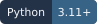
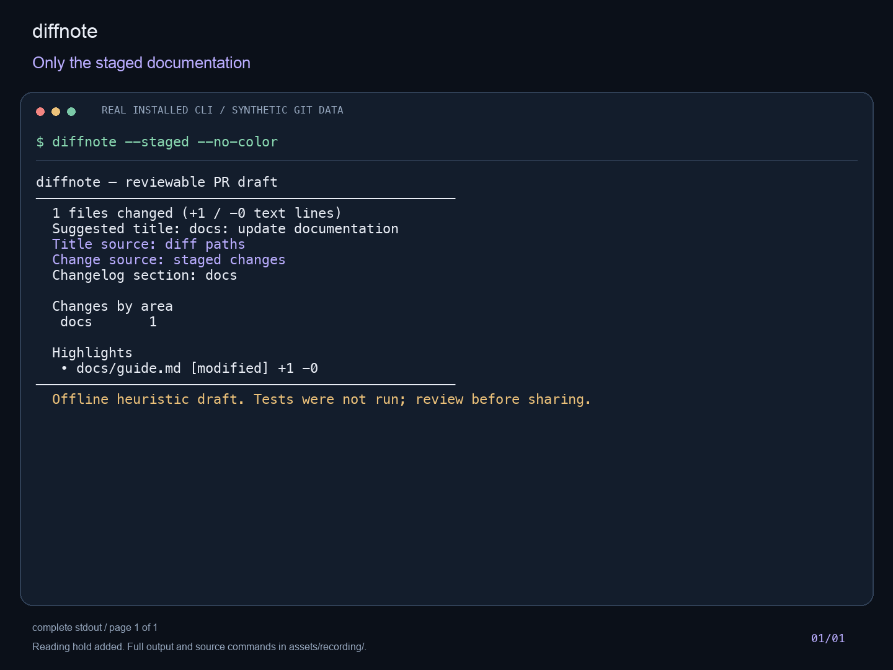
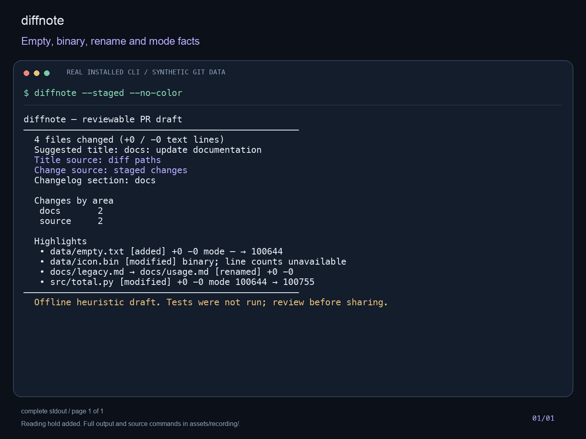
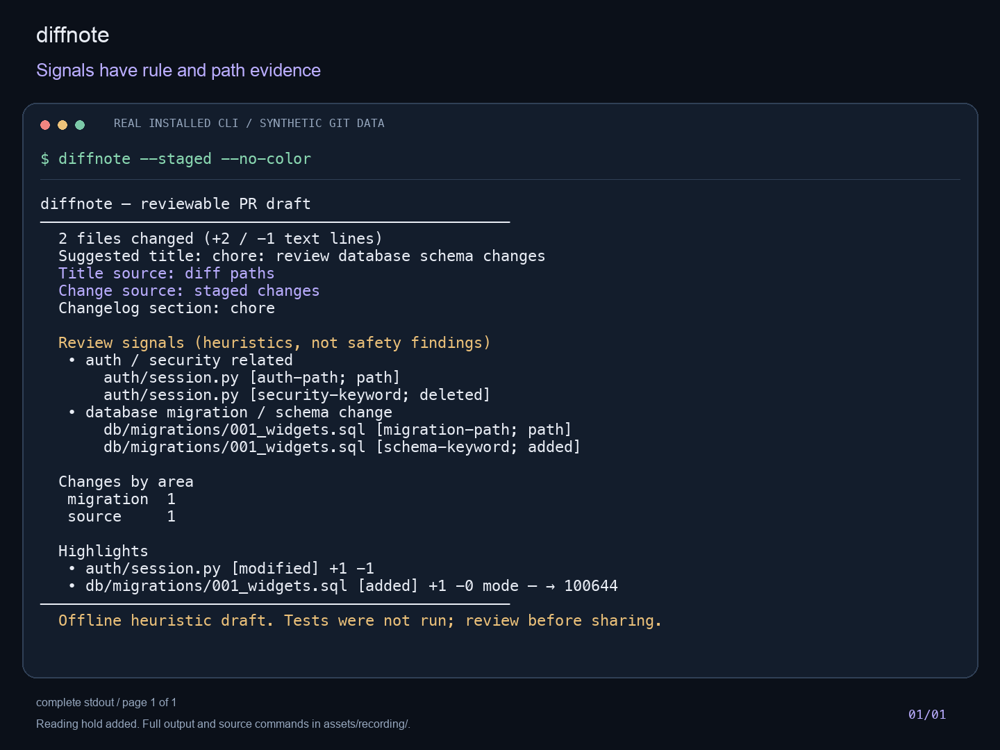
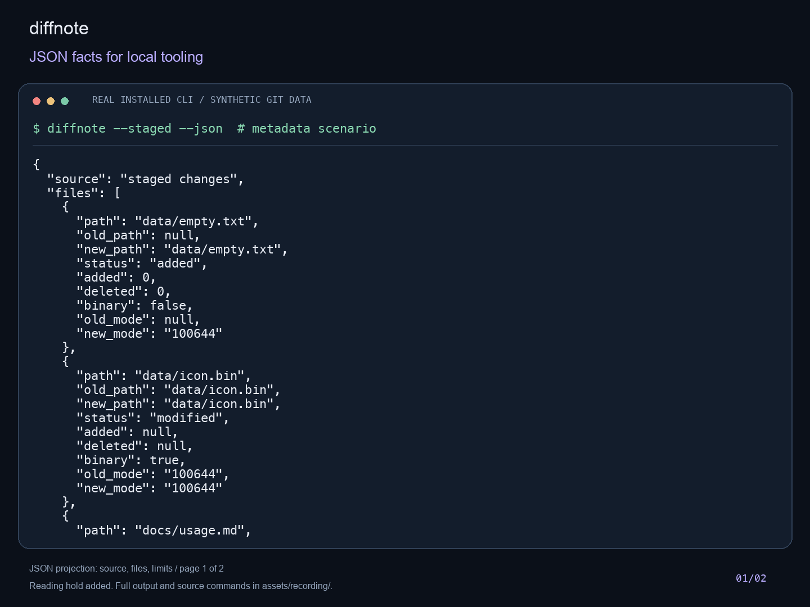
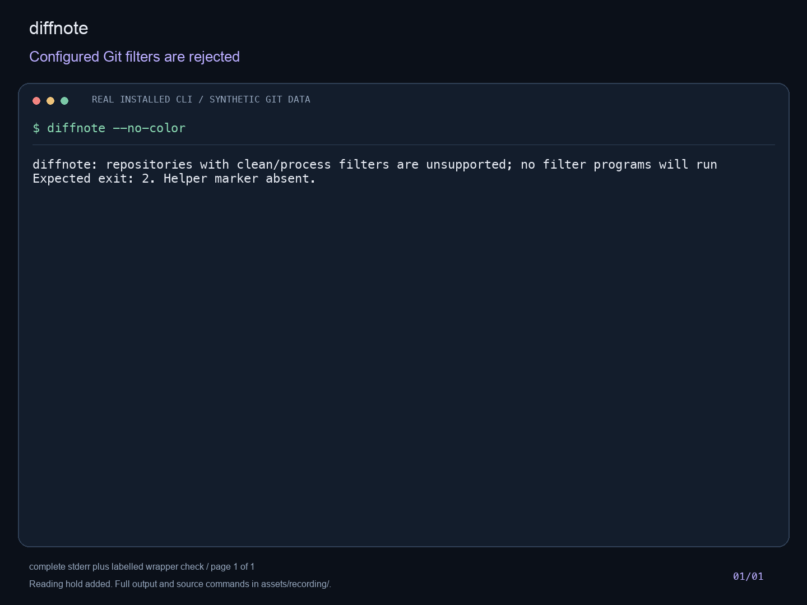
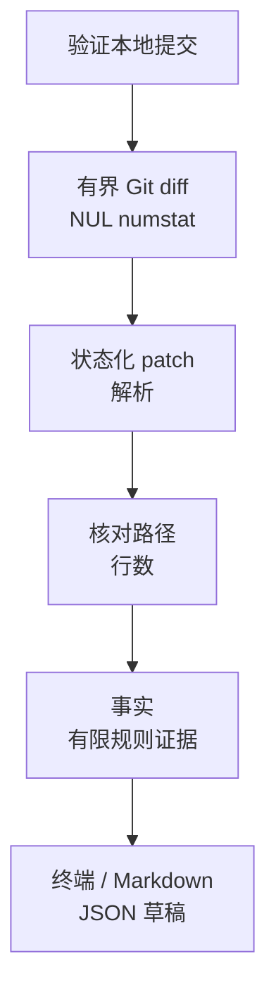

[English](guide.md) · **简体中文**

<p align="center"></p>

# diffnote

**从眼前这份改动，开始写 PR 说明。**

<p align="center">




</p>

把本地 Git 变更整理为可审阅草稿：改动区域、文件元数据、增删行数和有来源的复核线索。无需模型、API key 或服务器。

[English](../README.md) · [快速开始](#快速开始) · [选择-diff](#选择要描述的-diff) · [隐私与边界](#隐私与边界) · [MIT](../LICENSE)


真实本地 CLI 录制渲染为可读面板；GIF 为阅读增加 8–10 秒停留，并将 JSON 分页。没有编造打字或程序输出。[静态首图](../assets/demo.png) · [未修改的 cast](../assets/recording/showcase.cast) · [完整文本](../assets/recording/showcase.txt) · [来源与复现](../docs/showcase.md)。

五枚本地徽章仅说明源码元数据和已准备的配置；CI 不表示远端已通过，Stars 为 pending。
## 从 diff 到值得修改的第一稿

改了一个函数与对应测试，`git diff --stat` 告诉你大小；diffnote 把可见变更分组为草稿，并提供文件级复核依据。工作树和暂存区草稿的标题来自当前改动，不借用无关旧提交。

用它整理事实，再补上改动意图与真实验证。工具不运行测试、不推断作者真实意图，也不批准改动。

| 起点 | 继续用它做什么 | diffnote 补充什么 |
|---|---|---|
| `git diff` | 逐行读实际补丁 | 一份能放在补丁旁修改的结构化草稿 |
| `git diff --stat` | 快速看变更规模 | 区域、元数据与复核线索 |
| 提交日志 | 追踪已提交历史 | 暂存或未提交已跟踪改动的说明 |

## 快速开始

在本源码 checkout 内，使用 macOS/Linux、Python 3.11+、Git 2.31+：

```sh
python3 -m venv .venv
.venv/bin/python -m pip install .
.venv/bin/python scripts/demo.py
```

演示实际调用已安装 CLI，使用临时合成仓库并自动清理。安装可能下载构建工具；运行分析不调用网络或模型。此处不声称已发布包注册表或远端 CI 已通过。仓库元数据指向 LucasXlab/diffnote；这些源码文件不证明远端当前已发布哪个版本。

## 选择要描述的 diff

激活 `.venv` 后：

| 下一步任务 | 命令 | 范围 |
|---|---|---|
| 审阅下一次提交 | `diffnote --staged --markdown` | 仅暂存区 |
| 解释本地已跟踪改动 | `diffnote --markdown` | 工作树，含已暂存修改 |
| 准备分支草稿 | `diffnote --base main --markdown` | 已验证的本地 base 比较 |
| 交给本地脚本处理 | `diffnote --staged --json` | 结构化元数据与线索 |

未跟踪文件只有暂存后才纳入。把生成稿与补丁一起阅读，补上“为什么改”和真正执行的测试。分享前检查输出。

## 功能展示

### 让草稿对应下一次提交

工作树包含已暂存的已跟踪修改，`--staged` 只读取暂存区。本例工作树含源码和文档，暂存区只有文档；base/range 使用验证过的本地提交，见下方命令。



### 保留文件事实

空文件、二进制、重命名和执行权限不会在摘要中消失。二进制没有文本行数。JSON 保留 Unicode、引号及控制字符路径的身份；终端和 Markdown 将控制字符显示为可见文字。



### 线索可追溯到证据

有限规则给出路径、规则及新增/删除/路径来源；本例删除的安全关键词仍有依据。线索仅用于提醒复核补丁，没有线索不代表安全，工具不执行测试。



### 终端、Markdown 和 JSON

[完整 JSON](../assets/recording/metadata-json.json) 包含文件事实及限制。下图为明确标注的 `source/files/limits` 字段投影第 1 页，GIF 包含全部页；同时保留[完整 Markdown](../assets/recording/signals-markdown.stdout.txt)。



### 不支持的输入明确失败

解析路径与文本行数对照 Git NUL 分隔 numstat；冲突、不支持、截断或超限不会冒充无变更。本次实际过滤器拒绝返回 2，包装脚本另行确认 helper 标记不存在。



此前的 [README 演示图](../assets/readme-demo.png)、[文本节选](../assets/readme-demo.txt)和[复现说明](../docs/readme-demo.md)仍按原来源保留。

## 功能与命令

```sh
diffnote --staged --json
diffnote --base main --markdown
diffnote --range main..feature --json
diffnote --range main...feature --markdown
diffnote --commits 2
```

默认是已跟踪工作树（含暂存修改）；未跟踪文件需先暂存。`A..B` 比较两个提交端点，`A...B` 比较共同祖先至 B；`--commits N` 是最近 N 个 first-parent 提交的净变化，N 为 1–1000，浅历史不足时报错。无首提交分支使用空树。工作树/暂存标题仅来自当前文件，范围内可以明确标注来源的相关 conventional commit 标题。空结果的 JSON/Markdown 仍合法。

保留 Unicode、空格、引号、制表符/换行路径及真实文件身份，识别空文件、二进制、rename、mode 和 symlink mode。二进制不冒充有文本行数。解析后的路径/计数与 Git NUL 分隔 numstat 交叉核对；失败、截断或不支持的数据不会显示“无变更”。线索给出路径、规则和增/删/路径来源，不把没有线索当作安全。

退出 0 仅表示支持范围内分析完成；退出 2 表示参数、Git、限额、超时或解析错误。每条 Git 输出/patch 上限 8 MiB，每条 Git 超时 15 秒。JSON 与 Markdown 参数互斥；NO_COLOR、非 TTY 和 --no-color 均禁用颜色。

## 架构



## 隐私与边界

已移除可选 `--llm`/Ollama 层及相关环境变量，不需要 API key。隔离全局/系统 Git 配置和继承的 Git 覆盖变量，禁用 external diff、textconv、fsmonitor、验签显示；拒绝配置 clean/process filter 或 partial/promisor 对象或索引中存在子模块的仓库，避免这些 helper 或隐式抓取路径。

这是防御性的本地读取工具，不是隔离恶意 Git 二进制或损坏仓库的沙箱。只支持普通 unified patch；组合/冲突 patch 拒绝处理。多个读取命令不是事务，并发修改可能使交叉核对失败，使用时应停止并发写入。输出含真实路径/提交标题，可能带私人信息，分享前人工检查；终端/Markdown 将控制字符可见化，JSON 保留身份。详见 [PRIVACY.md](../PRIVACY.md)、[SECURITY.md](../SECURITY.md)。

## 开发

```sh
make dev
make check
make demo
```

check 实跑 lint/format、整包语句覆盖（至少70%）、sdist/wheel、全新虚拟环境源码外 wheel 冒烟。可指定 PYTHON/VENV。CI 配置 Python3.11/3.13；配置存在不代表远端运行通过。用 `make format` 格式化。

## 路线与贡献

未来扩展明确支持的 diff 格式、独立标注真实 PR 评估、可配置分组；小样本抽检不能代替准确率评估。贡献请读 [CONTRIBUTING.md](../CONTRIBUTING.md)，使用合成复现，不在公开问题里贴私人 diff 或凭据。

## 许可证

[MIT](../LICENSE)，保留已有版权署名。
